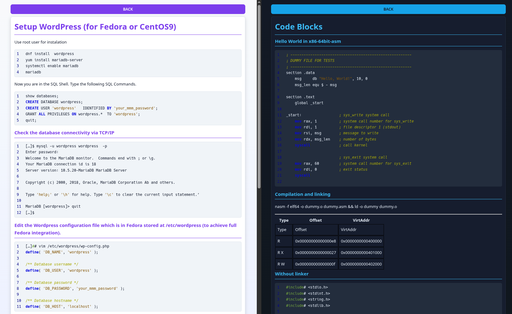

# Markdown server



# build with different themes

```
cargo run --no-default-features --features theme-green-black
cargo run --no-default-features --features theme-light-modern
cargo run --no-default-features --features theme-black-white
cargo run --no-default-features --features theme-dark-blue
```

